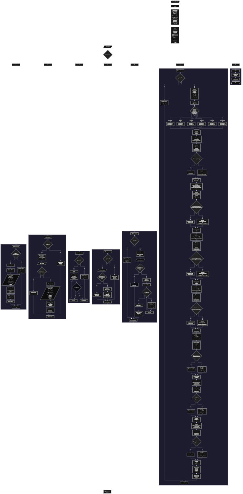

Este proyecto, llamado <b>ascenso deportivo</b>, fue desarrollado en <b>java</b> como un ejercicio práctico para fortalecer la lógica de programación mediante la creación de un sistema de gestión de ascensos deportivos desde la consola. El programa cuenta con un menú principal de siete opciones que permite <b>registrar, editar, listar, buscar, eliminar y consultar el resumen</b> de los ascensos registrados. Cada ascenso almacena información como el nombre del deportista, la disciplina deportiva, la categoría actual, la categoría destino, el entrenador, los puntos obtenidos, las victorias, las derrotas, la fecha de evaluación y el estado del ascenso, utilizando diez arreglos paralelos con una capacidad máxima de <b>10 registros durante la ejecución</b>. Durante su desarrollo se aplicaron conceptos fundamentales de programación, como variables, arreglos, estructuras condicionales, ciclos repetitivos y estructuras de selección, además de procesos para buscar, modificar, eliminar y organizar registros. También se implementaron análisis estadísticos para identificar las disciplinas, categorías, entrenadores y estados más frecuentes, así como los deportistas con mayor cantidad de puntos y victorias. Este proyecto permite poner en práctica los conocimientos adquiridos en java y sirve como base para desarrollar sistemas de gestión deportiva más avanzados.

<h2 align="center">⚙️ Funcionamiento del menú principal</h2>

### ➕ Registrar ascenso

La opción <b>1) registrar ascenso</b> permite almacenar un nuevo ascenso deportivo. Antes de realizar el registro, el sistema comprueba que la cantidad de ascensos almacenados sea menor a <b>10</b>, utilizando la condición <b>total &gt;= deportistas.length</b> para determinar si se alcanzó la capacidad máxima de los arreglos. Si existe espacio disponible, la variable <b>id</b> genera el identificador del nuevo registro mediante la operación <b>total + 1</b> y el programa solicita el <b>nombre del deportista, disciplina deportiva, categoría actual, categoría destino, nombre del entrenador, puntos obtenidos, cantidad de victorias, cantidad de derrotas, fecha de evaluación y estado del ascenso</b>. Los datos se almacenan en la posición correspondiente de sus respectivos arreglos. Finalmente, muestra el mensaje <b>"ascenso registrado correctamente."</b> e incrementa la variable <b>total</b> en uno. Si los arreglos alcanzan su capacidad máxima, presenta el mensaje <b>"no hay espacio para registrar más ascensos."</b>, impidiendo agregar otro registro.

### ✏️ Editar ascenso

La opción <b>2) editar ascenso</b> permite modificar la información de un ascenso deportivo registrado. Primero, el programa comprueba si existen ascensos almacenados mediante la variable <b>total</b>. Si no hay registros, muestra el mensaje <b>"no existen ascensos registrados."</b>. En caso contrario, presenta una lista con el identificador, deportista, disciplina, categoría actual, categoría destino, entrenador, puntos, victorias, derrotas, fecha de evaluación y estado de cada ascenso. Después, solicita el identificador del registro que se desea editar y comprueba que esté dentro del rango permitido mediante la condición <b>idEditar &gt;= 1 &amp;&amp; idEditar &lt;= total</b>. Si la selección es válida, calcula la posición correspondiente utilizando <b>idEditar - 1</b> y solicita nuevamente los diez datos del ascenso, actualizando directamente los valores de los arreglos correspondientes. Finalmente, presenta el mensaje <b>"ascenso actualizado correctamente."</b>. Si el identificador seleccionado no corresponde a un registro existente, muestra el mensaje <b>"id no encontrada."</b>.

### 📋 Listar ascensos

La opción <b>3) listar ascensos</b> permite visualizar todos los ascensos deportivos registrados actualmente en el programa. Antes de mostrar la información, comprueba si la variable <b>total</b> es igual a <b>0</b>. Si no existen registros, presenta el mensaje <b>"no existen ascensos registrados."</b>. Si hay ascensos disponibles, muestra el encabezado <b>"lista de ascensos deportivos"</b> y utiliza un ciclo <b>for</b> para recorrer los arreglos desde la primera posición hasta la cantidad total de registros almacenados. Durante el recorrido, muestra el identificador y los diez datos correspondientes a cada ascenso: deportista, disciplina, categoría actual, categoría destino, entrenador, puntos, victorias, derrotas, fecha de evaluación y estado. Esta función facilita consultar todos los registros existentes sin necesidad de buscar cada ascenso individualmente.

### 🔎 Buscar ascenso

La opción <b>4) buscar ascenso</b> permite localizar un ascenso deportivo mediante su identificador. Primero, el programa comprueba si existen registros almacenados. Si no hay ascensos, muestra el mensaje <b>"no existen ascensos registrados."</b>. En caso contrario, presenta el encabezado <b>"búsqueda de ascenso"</b> y solicita el identificador que se desea consultar. Después, verifica que el valor introducido esté dentro del rango permitido mediante la condición <b>idBusqueda &gt;= 1 &amp;&amp; idBusqueda &lt;= total</b>. Si el identificador es válido, obtiene la posición del registro utilizando <b>idBusqueda - 1</b> y muestra todos sus datos: deportista, disciplina, categoría actual, categoría destino, entrenador, puntos, victorias, derrotas, fecha de evaluación y estado. Si el identificador no corresponde a un ascenso registrado, presenta el mensaje <b>"id no encontrada."</b>. La búsqueda se realiza directamente mediante el identificador y la posición correspondiente en los arreglos.

### 🗑️ Eliminar ascenso

La opción <b>5) eliminar ascenso</b> permite eliminar un ascenso deportivo mediante su identificador dentro de los registros almacenados. Antes de comenzar, el programa comprueba que existan ascensos registrados. Si no hay información disponible, muestra el mensaje <b>"no existen ascensos registrados."</b>. Si existen registros, presenta una lista con el identificador y los diez datos de cada ascenso. Después, solicita el identificador del registro que se desea eliminar y verifica que esté dentro del rango válido mediante la condición <b>idEliminar &gt;= 1 &amp;&amp; idEliminar &lt;= total</b>. Si el ascenso existe, calcula su posición mediante <b>idEliminar - 1</b> y utiliza un ciclo <b>for</b> controlado por la variable <b>i</b> para desplazar una posición hacia atrás los datos de los registros posteriores en los diez arreglos: <b>deportistas, disciplinas, categoriasActuales, categoriasDestino, entrenadores, puntos, victorias, derrotas, fechasEvaluacion y estados</b>. Posteriormente, disminuye la variable <b>total</b> en uno y muestra el mensaje <b>"ascenso eliminado correctamente."</b>. Si el identificador seleccionado no corresponde a un ascenso registrado, presenta el mensaje <b>"id no encontrada."</b>. El programa no limpia explícitamente la última posición ocupada, ya que esta queda fuera de los registros activos al disminuir el contador total.

### 📊 Mostrar resumen

La opción <b>6) mostrar resumen</b> permite consultar información estadística de los ascensos deportivos registrados. Primero, el programa comprueba si existen registros mediante la variable <b>total</b>. Si no hay ascensos almacenados, muestra el mensaje <b>"no existen ascensos registrados."</b>. En caso contrario, comienza contabilizando los estados de los ascensos mediante un ciclo <b>for</b> y las estructuras condicionales <b>if</b> y <b>else if</b>, utilizando el método <b>equalsIgnoreCase()</b> para clasificar los registros en seis grupos: <b>pendientes, aprobados, rechazados, ascendidos, en evaluación y otros estados</b>. Posteriormente, realiza diferentes análisis de frecuencia mediante ciclos <b>for</b> anidados para identificar la <b>disciplina más frecuente, categoría actual más frecuente, categoría destino más solicitada, entrenador con más deportistas y estado más frecuente</b>. También utiliza <b>Integer.parseInt()</b> para convertir los puntos y las victorias almacenados como texto en valores enteros, permitiendo identificar al <b>deportista con más puntos y al deportista con más victorias</b>. Finalmente, presenta el total de ascensos registrados, los siete resultados estadísticos y las cantidades correspondientes a los seis grupos de estados.

### 🚪 Salir del menú principal

La opción <b>7) salir</b> permite finalizar la ejecución del programa y muestra el mensaje <b>"gracias por utilizar ascenso deportivo."</b>. El menú principal se encuentra dentro de una estructura repetitiva <b>do-while</b>, que mantiene el programa en funcionamiento mientras la variable <b>opcion</b> sea diferente de <b>7</b>. Cuando el usuario selecciona esta opción, el ciclo termina y se ejecuta la instrucción <b>entrada.close()</b>, encargada de cerrar el objeto <b>Scanner</b> utilizado para recibir los datos desde la consola.

<h2 align="center">🧠 Temas aplicados en el proyecto</h2>

### 📦 Variables

En este proyecto se utilizan variables para almacenar la opción seleccionada en el menú, controlar la cantidad de ascensos registrados, generar identificadores, determinar las posiciones de los registros que se desean editar, buscar o eliminar, recorrer los arreglos y realizar los diferentes cálculos estadísticos. También se utilizan variables para contabilizar los estados de los ascensos, identificar las categorías y disciplinas más frecuentes y determinar los deportistas que obtuvieron la mayor cantidad de puntos y victorias. Cada variable cumple una función específica dentro de las operaciones de gestión y análisis de la información deportiva.

🔢 **Opcion:** Almacena la opción seleccionada por el usuario en el menú principal.

📊 **Total:** Controla la cantidad actual de ascensos deportivos registrados.

🆔 **Id:** Genera el identificador del nuevo ascenso mediante la operación `total + 1`.

✏️ **IdEditar:** Almacena el identificador del ascenso que se desea modificar.

🔎 **IdBusqueda:** Almacena el identificador del ascenso que se desea consultar.

🗑️ **IdEliminar:** Almacena el identificador del ascenso que se desea eliminar.

📍 **Posicion:** Determina la posición correspondiente al registro seleccionado mediante la operación `id - 1`.

🔄 **I:** Funciona como contador en los ciclos `for` utilizados para recorrer los arreglos y realizar diferentes operaciones.

🔁 **J:** Controla el recorrido interno de los ciclos `for` anidados utilizados para comparar los datos y calcular sus frecuencias.

📋 **Pendientes, Aprobados, Rechazados, Ascendidos, EnPausa y OtrosEstados:** Almacenan las cantidades de ascensos clasificados según su estado. 

📈 **DisciplinaMayor, CategoriaActualMayor, CategoriaDestinoMayor, EntrenadorMayor y EstadoMayor:** Almacenan los valores que presentan la mayor frecuencia en sus respectivos análisis.

🏆 **DeportistaMayorPuntos y DeportistaMayorVictorias:** Almacenan los nombres de los deportistas que obtuvieron la mayor cantidad de puntos y victorias.

🔢 **CantidadDisciplinaMayor, CantidadCategoriaActualMayor, CantidadCategoriaDestinoMayor, CantidadEntrenadorMayor y CantidadEstadoMayor:** Almacenan las frecuencias máximas encontradas durante los análisis de los datos.

📊 **MayorPuntos y MayorVictorias:** Almacenan las cantidades máximas de puntos y victorias identificadas en los registros.

🔄 **CantidadDisciplina, CantidadCategoriaActual, CantidadCategoriaDestino, CantidadEntrenador y CantidadEstado:** Funcionan como contadores temporales para calcular las frecuencias de cada valor durante los recorridos internos.

### 🗃️ Arreglos

En este proyecto se utilizan diez arreglos paralelos relacionados con la información de cada ascenso deportivo. Cada arreglo tiene una capacidad de <b>10 posiciones</b> y utiliza el mismo índice para representar los datos correspondientes a un mismo registro. Por ejemplo, la información de un deportista almacenado en la posición <b>0</b> se encuentra distribuida entre <b>deportistas[0], disciplinas[0], categoriasActuales[0], categoriasDestino[0], entrenadores[0], puntos[0], victorias[0], derrotas[0], fechasEvaluacion[0] y estados[0]</b>. Esta organización permite recorrer, buscar, modificar, mostrar y eliminar los ascensos de manera ordenada.

🏃 **Deportistas[10]:** Almacena los nombres de los deportistas registrados.

⚽ **Disciplinas[10]:** Almacena las disciplinas deportivas correspondientes a cada ascenso.

🥇 **CategoriasActuales[10]:** Almacena las categorías actuales de los deportistas.

🎯 **CategoriasDestino[10]:** Almacena las categorías a las que desean ascender los deportistas.

👨‍🏫 **Entrenadores[10]:** Almacena los nombres de los entrenadores responsables de los deportistas.

📊 **Puntos[10]:** Almacena los puntos obtenidos por cada deportista.

🏆 **Victorias[10]:** Almacena la cantidad de victorias de cada deportista.

📉 **Derrotas[10]:** Almacena la cantidad de derrotas de cada deportista.

📅 **FechasEvaluacion[10]:** Almacena las fechas en las que se realizan las evaluaciones de los ascensos.

📋 **Estados[10]:** Almacena los estados correspondientes a cada ascenso deportivo.

### 🔀 Estructuras condicionales

En este proyecto se utilizan las estructuras <b>if, else if y else</b> para comprobar si existe espacio disponible antes de registrar un ascenso, verificar si hay registros almacenados antes de ejecutar determinadas operaciones, validar los identificadores seleccionados para editar, buscar o eliminar ascensos y determinar los resultados de los análisis estadísticos. También se utilizan para clasificar los ascensos según sus estados y comparar las cantidades de puntos y victorias de los deportistas. Estas condiciones permiten que el programa responda de manera diferente según la información almacenada y el resultado de cada operación. Además, se utiliza la estructura <b>switch</b> para seleccionar la funcionalidad correspondiente a cada opción del menú principal.

### 🔄 Estructuras repetitivas

En este proyecto se utilizan los ciclos <b>do-while</b> y <b>for</b>. El ciclo <b>do-while</b> mantiene activo el menú principal y permite ejecutar las diferentes operaciones hasta que el usuario selecciona la opción <b>7</b>. Los ciclos <b>for</b> permiten recorrer los arreglos para mostrar, editar, buscar y eliminar los ascensos registrados, además de realizar los conteos y comparaciones utilizados en el resumen estadístico. También se utilizan ciclos <b>for</b> anidados para comparar los valores de los arreglos y determinar cuáles aparecen con mayor frecuencia. Estos recorridos permiten analizar la información almacenada sin utilizar estructuras adicionales.

### 🎯 Estructura según

El programa utiliza la estructura <b>switch</b> para evaluar el valor almacenado en la variable <b>opcion</b> y ejecutar el bloque de instrucciones correspondiente. Cada caso representa una operación específica del sistema: <b>registrar ascenso, editar ascenso, listar ascensos, buscar ascenso, eliminar ascenso, mostrar resumen y salir</b>. También se utiliza el bloque <b>default</b> para mostrar el mensaje <b>"opción no válida."</b> cuando el usuario introduce un número que no coincide con ninguna de las opciones definidas en el menú. De esta manera, la estructura de selección organiza las funcionalidades del programa y facilita la navegación entre sus diferentes operaciones.

### 🔢 Dimensionamiento de arreglos

El programa utiliza la declaración de arreglos mediante la instrucción <b>new String[10]</b> para establecer la capacidad de los diez arreglos que almacenan la información de los ascensos deportivos. Cada arreglo dispone de <b>10 posiciones</b>, lo que permite administrar hasta diez registros durante la ejecución del programa. La cantidad de posiciones ocupadas se controla mediante la variable <b>total</b>, mientras que la propiedad <b>length</b> permite comprobar la capacidad máxima disponible antes de realizar un nuevo registro. De esta manera, las operaciones trabajan únicamente con los ascensos que se encuentran registrados.

### 🔄 Reorganización de registros

Cuando se selecciona un ascenso para eliminarlo, el programa utiliza un ciclo <b>for</b> que comienza en la posición seleccionada y continúa mientras <b>i &lt; total - 1</b>. En cada repetición, los datos de la posición siguiente se copian sobre la posición actual en los diez arreglos: <b>deportistas, disciplinas, categoriasActuales, categoriasDestino, entrenadores, puntos, victorias, derrotas, fechasEvaluacion y estados</b>. Después de completar el desplazamiento, la variable <b>total</b> disminuye en uno. De esta manera, los registros posteriores ocupan las posiciones disponibles sin dejar espacios vacíos entre los ascensos activos. La última posición no se limpia explícitamente, sino que deja de formar parte de los registros activos al actualizar el contador.

<h2 align="center">¿Cómo se implementaron las operaciones crud en el proyecto?</h2>

Las operaciones <b>crud</b> se implementaron mediante las opciones del menú principal, permitiendo administrar los ascensos deportivos registrados. La operación <b>crear</b> corresponde a <b>registrar ascenso</b>, donde se introducen los diez datos de un nuevo deportista; <b>leer</b> se realiza mediante las opciones <b>listar ascensos y buscar ascenso</b>, que permiten consultar todos los registros o localizar uno mediante su identificador; <b>actualizar</b> corresponde a <b>editar ascenso</b>, donde se modifican los datos de un registro existente; y <b>eliminar</b> se realiza mediante la opción <b>eliminar ascenso</b>, que reorganiza los datos de los arreglos después de retirar un registro. Estas operaciones utilizan variables, arreglos, estructuras condicionales y ciclos repetitivos para gestionar la información almacenada temporalmente durante la ejecución del programa.

<h2 align="center">Diagrama de flujo del proyecto</h2>

<h2 align="center">🛡️ Validaciones del programa</h2>

### 📭 No existen ascensos registrados

Esta validación se utiliza en las opciones de <b>editar, listar, buscar, eliminar y mostrar resumen</b>. El programa comprueba si la variable <b>total</b> es igual a <b>0</b> y, si no existen ascensos registrados, muestra el mensaje <b>"no existen ascensos registrados."</b>. Esta comprobación evita continuar con las operaciones que necesitan información almacenada cuando todavía no hay registros disponibles.

### ⚠️ Capacidad máxima de registros

Esta validación se utiliza durante el registro de nuevos ascensos para controlar la capacidad máxima de los arreglos. El programa comprueba si <b>total &gt;= deportistas.length</b> antes de permitir agregar un nuevo registro. Si existe espacio disponible, genera el identificador y solicita los diez datos del ascenso. En caso contrario, muestra el mensaje <b>"no hay espacio para registrar más ascensos."</b>, impidiendo almacenar más registros cuando se alcanza la capacidad máxima de diez posiciones.

### 🔢 Identificador dentro del rango permitido

Esta validación se utiliza en las operaciones de <b>editar, buscar y eliminar ascenso</b>. El programa comprueba que el identificador introducido sea mayor o igual a <b>1</b> y menor o igual al valor de <b>total</b>. Si la selección está dentro de ese rango, calcula la posición correspondiente mediante la operación <b>id - 1</b> y continúa con la operación solicitada. Si el identificador no corresponde a un ascenso registrado, muestra el mensaje <b>"id no encontrada."</b>. Esta comprobación evita acceder a posiciones que no corresponden a registros activos.

### ❌ Datos numéricos para el resumen

Durante la opción <b>mostrar resumen</b>, el programa utiliza el método <b>Integer.parseInt()</b> para convertir los valores almacenados en los arreglos <b>puntos</b> y <b>victorias</b> en números enteros. Esta conversión permite comparar las cantidades y determinar los deportistas con los mejores resultados. Sin embargo, el programa no incorpora una validación previa para comprobar que los datos introducidos en estos campos sean valores numéricos, por lo que se espera que el usuario registre cantidades enteras válidas.

### ⚠️ Opción no válida

La estructura <b>switch</b> incluye el bloque <b>default</b>, que muestra el mensaje <b>"opción no válida."</b> cuando el usuario introduce un número que no corresponde a ninguna de las siete opciones definidas en el menú principal. Esta condición permite informar al usuario cuando selecciona una alternativa que no está disponible en el programa.

<h2 align="center">🎯 Objetivo del proyecto</h2>

El objetivo principal de este proyecto es fortalecer la <b>lógica de programación</b> mediante el desarrollo de un sistema de gestión de ascensos deportivos en <b>java</b>. A través de su construcción se busca aplicar los conocimientos adquiridos sobre variables, arreglos, estructuras condicionales, ciclos repetitivos y estructuras de selección, integrándolos para resolver un problema de administración deportiva de manera organizada. Además, el proyecto permite comprender cómo registrar, consultar, modificar y eliminar información, así como realizar análisis estadísticos para identificar frecuencias y resultados destacados entre los deportistas. De esta manera, se establece una base para desarrollar sistemas de gestión más completos utilizando otros lenguajes y tecnologías.

